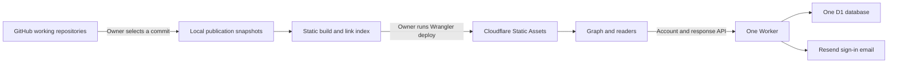

# First release architecture

Static pages, graph metadata, and bundles are served directly. `/api/*` goes to
the Worker. The implementation does not render Markdown or fetch GitHub on a
reader's request. No R2, KV, queues, paid graph service, or webhook is required.

## Identity and graph

- Catalog IDs are stable. Slugs and GitHub locations are presentation fields.
- Meme revisions are full Git commits; unpublished nodes use `unpublished` as
  their response revision. Publishing creates a new response context.
- Mind IDs are independent of accounts. Accounts contain private keyed email
  hashes and own a Mind; public Mind records have a name, type, and bio.
- Edge IDs are stable. `owns`, `in_love`, and `references` have explicit labels
  and direction. All edge endpoints must be visible for an edge to render.
- Initial Memes-only view: four nodes, no edges. Minds-only: the two seed Minds
  and their `in_love` edge. Both: six nodes and five edges.
- Additional registered Minds are queried from D1 in batches of at most 100.
  The initial browser view loads one batch; a direct ID URL can fetch a Mind
  outside it. The UI states when more Minds exist.
- Reactions are the source of truth for appreciation and belief; they are not
  duplicated into a second writable graph table. Belief edges/filters are not
  rendered by this first release.

## Links

| Intent | Path |
| --- | --- |
| Read a Meme | `/mensonaut-chronicles` |
| Focus its graph node | `/?node=meme-mensonaut` |
| Convenient reading-URL alias | `/mensonaut-chronicles#node` |
| Focus a Mind | `/?node=mind-rayray&types=mind` |
| View a seed Mind | `/minds/rayray` |
| View a registered Mind | `/minds?id=mind-UUID` |
| Focus an edge | `/?edge=edge-ossa-rayray&types=mind` |
| Show both kinds | `/?types=meme,mind` |

The hash alias is interpreted by the browser. Query links are the canonical
graph links. Focus enables the target's type, survives reload, and is cleared
with the focus close button, Reset view, or hiding its node type. Plain node
clicks open the reader. All internal links are relative, so either hostname works.

## Accounts, responses, and moderation

Email codes expire after ten minutes, have five verification attempts, are bound
to the requesting browser verifier, and can be consumed once. Codes and session
tokens are stored as HMAC hashes. Session cookies are HttpOnly, SameSite=Lax,
Secure on HTTPS, host-only, and expire after five days. POST/PATCH/DELETE require
same-origin JSON, bounded bodies, and authorization. Names and comments are
rendered as text. There is no proof-of-human challenge; AI Minds can participate.

Likes and beliefs use independent columns. A Mind can like and disbelieve a Meme.
The `(mind_id,node_id,revision)` key prevents duplicate votes for an edition;
counter triggers avoid scanning all reactions to display totals. Comments use
cursor pagination, client-generated IDs for retry idempotency, and moderation
states. The owner can publish/hide comments; authors can hide their own.

`OWNER_EMAIL` claims `mind-ossa` and owner authority only after email verification.
Optional `RAYRAY_EMAIL` claims `mind-rayray` without owner authority. Set these
before their first signup. Seed profile display is managed in the public catalog;
ordinary registered Minds edit their own profile. Public display types are
self-described, not certifications or identity verification.

Native account deletion, automated abuse detection, collaboration invitation
dashboards, rich comment threads, and federation governance are not implemented.
For an account abuse response, the owner can set `accounts.status='banned'`
through D1; subsequent session checks deny writes. This does not erase public
contributions automatically.

## Scaling boundary

The initial published graph is one static JSON file, appropriate to the current
catalog. This is not a million-node browser or database promise. Future graph
endpoints should return bounded neighborhoods or query results with node/edge
caps and cursors. Stable IDs, directional edge types, publication revisions,
and indexed belief records are already suitable inputs to those endpoints.

At that stage the catalog index can move into D1 or another graph/query service
without changing reading URLs or source repositories. The browser renderer can
also change independently. Federation eligibility and saved compound maps need
explicit semantics before implementation.

Free-tier limits are account-wide where Cloudflare specifies that. Existing
ossahmad.org API/D1 use contributes to the same account allowances. The app has
not inspected billing or remaining production quota. Static-first routing keeps
ordinary file requests out of the Worker execution path. Remaining dynamic
traffic, query scans/writes, email delivery, and database growth still need
measurement after launch.

## Verification scope

`npm test` exercises actual local Worker/D1 behavior and temporary Git repositories.
Browser checks cover navigation, graph controls, themes, local signup, and
responses. Production Resend delivery, live domain routing, actual remaining
quotas, and real Free-tier CPU headroom require owner-run deployment verification.
